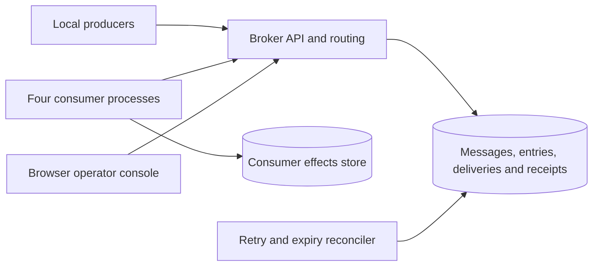

# Reliable Message Broker

Publish synthetic work with a durable receipt, give consumers bounded delivery authority, and explain every retry or dead letter. A stopped process should leave recoverable records rather than an unexplained missing message.

**Stage:** requirements and design baseline, 20 November 2026. This repository contains the complete documentation project. The runtime engine has not been implemented; acceptance and performance results are NOT RUN.

Start with the [documentation guide](docs/README.md), [product requirements](docs/requirements/product.md), [high-level design](docs/architecture/high-level-design.md), and [component designs](docs/design/README.md).

The project includes software/quality requirements, API and data contracts, browser journeys, transaction protocols, state machines, security, operations, failure tests, acceptance traceability and delivery milestones. The supplied requirements are preserved [unchanged](docs/source/Reliable_Message_Broker_Requirements.md).

A message can have independent entries in several queues. A publish receipt proves atomic routing, while an ACK settles one queue entry. Consumer execution can repeat; external exactly-once processing is outside scope.

The proposed reference stack is Python with a locally served browser interface and SQLite on local disk, subject to the permitted mirror and desktop verification gate. Runtime communication stays on loopback. No cloud, Docker or real private data is required.

Licensed under [MIT](LICENSE).

## Examples and schemas

See [worked examples](examples/README.md), [JSON Schemas](schemas/README.md), and the [reference database schema](schemas/reference-schema.sql).
