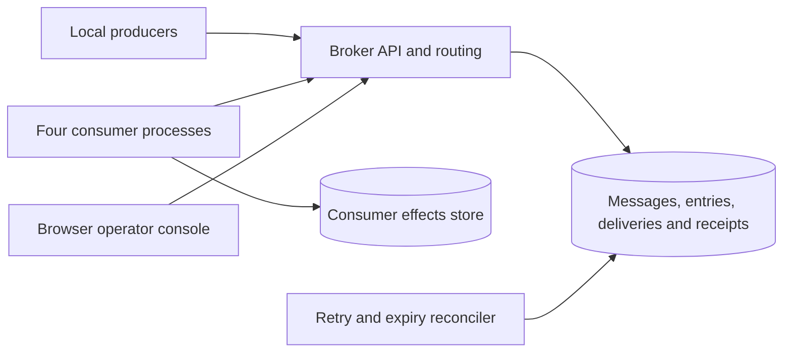
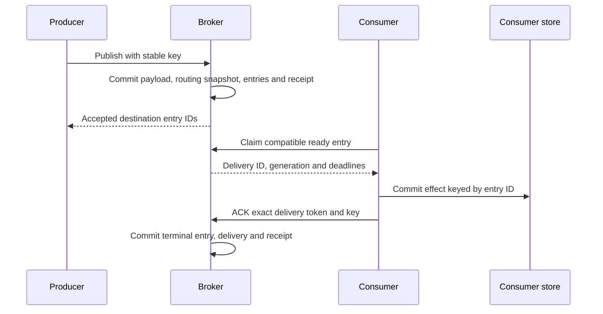

# High-level design

Publish synthetic work with a durable receipt, give consumers bounded delivery authority, and explain every retry or dead letter. A stopped process should leave recoverable records rather than an unexplained missing message.

A message can have independent entries in several queues. A publish receipt proves atomic routing, while an ACK settles one queue entry. Consumer execution can repeat; external exactly-once processing is outside scope.

## System context and deployment

All runtime services run as ordinary local processes. The browser uses same-origin HTTP, locally bundled assets and no telemetry/CDN. Canonical storage sits on supported local disk outside synchronized folders. Separate consumer/replica stores remain separate correctness boundaries.

## End-to-end sequence

## Component responsibilities

| Component | Responsibility |
| --- | --- |
| [Queue administration and atomic routing](../design/routing.md) | Validate names, existing destination queues and expected settings/binding revision. |
| [Producer validation and receipts](../design/publish.md) | Bound JSON payload and metadata; validate producer, route, key and optional TTL. |
| [Claims and delivery authority](../design/deliveries.md) | Begin mutation before reading candidate eligibility or shared occupancy. |
| [ACK NACK and consumer effects](../design/acknowledgements.md) | Match immutable accepted receipt first for an identical retry. |
| [Retry TTL expiry and recovery](../design/recovery.md) | Scan due TTL, delivery deadlines and retry timestamps in bounded batches. |
| [Dead letters and controlled redrive](../design/dead-letters.md) | Preserve terminal source entry, immutable payload reference, attempts and reason in one dead-letter transaction. |
| Control API | Parse requests, enforce roles/revisions/keys, dispatch domain services, return durable outcomes |
| Browser | Explain authoritative state and pending intent without advancing progress locally |
| Storage | Enforce uniqueness, foreign keys, immutable history and atomic mutation boundaries |
| Failure harness | Control exact stop points and query committed-state invariants |

Read the [data model](../contracts/data-model.md), [API contract](../contracts/api.md) and [transaction protocol](../design/transactions.md) together. No in-memory queue, local UI state or process lock is the sole correctness mechanism.
