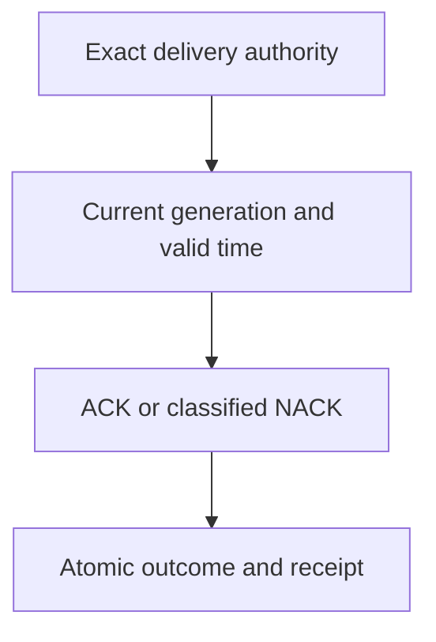

# ACK NACK and consumer effects

A committed ACK receipt can be replayed after expiry without reviving old authority. Consumer effect and broker ACK are separate commits: kill after the first to prove deduplication. Redrive gets a new entry ID and therefore a deliberate new logical processing effect.

## Operation algorithm

1. Match immutable accepted receipt first for an identical retry.
2. For new ACK/NACK/extend verify entry, delivery, consumer, generation, lease, processing deadline and TTL.
3. ACK closes the delivery and entry with audit/receipt; NACK either schedules retry or creates a dead letter atomically.
4. A built-in consumer commits its own effect with a unique entry ID before ACK; redelivery checks that same effect identity.

## Inputs outputs and ownership

The service receives a validated domain request, caller/process identity, target identity, expected revision or epoch where applicable, and stable operation key. Read authoritative mutable state inside the accepting transaction. Return the committed receipt/current bounded result, or a stable error without implying acceptance. Interfaces and fields are specified in the [API](../contracts/api.md) and [data model](../contracts/data-model.md).

## Atomicity and failure handling

Publish locks one routing snapshot and all destination admission decisions in one canonical transaction. Claim protects shared capacity and authority together. ACK/NACK/expiry/redrive each commits its event and receipt with the state transition. Consumer effects use a separate store and deduplicate by queue-entry identity.

Use conditional source-state checks, uniqueness constraints and atomic audit/receipt writes. On contention roll back and retry the entire operation under bounded backoff, preserving the key. On uncertain response consult the receipt before repeating work. A stale revision/epoch requires refresh or fresh authority, never a silently rewritten request. Database unavailability stops new confirmations.

## Detailed behavior inherited from the source

## Claim leases and acknowledgements

| ID | Requirement |
| --- | --- |
| DEL-01 | Claim atomically checks queue state, eligibility, TTL and global/queue/consumer in-flight limits. Process-memory counters are insufficient. |
| DEL-02 | Claim records consumer instance, generation, attempt number and visibility deadline. Every claim consumes an attempt. |
| DEL-03 | Default visibility is 15 seconds with extension every 5 seconds; lease expiry is never later than message expiry. |
| DEL-04 | Extension requires current unexpired authority and cannot revive an expired generation. A fixed maximum processing deadline bounds repeated extension. |
| DEL-05 | ACK, NACK and extension carry entry ID, delivery ID, consumer ID, generation and operation key. |
| DEL-06 | Identical accepted ACK retries return the original receipt even after settlement; new stale ACKs cannot affect a newer delivery. |
| DEL-07 | Consumer registration uses a fresh process-instance ID. A restarted process does not inherit authority merely by reusing a friendly name. |
| DEL-08 | Backpressure stops issuing work when capacity is full; reads and diagnostics remain available. |

The default maximum processing duration is 60 seconds per delivery, independent of extensions. Time is sampled from the durable store's chosen wall-clock authority; exact equality to a deadline is expired. Recheck authority at the serialized mutation point. Record clock-source and clock-jump limitations.

## Ordering concurrency and transaction requirements

READY selection uses eligible timestamp then stable entry ID. Parallel consumers, retries and requeues can change completion order; strict FIFO processing is not promised. No second delivery is authorized until the prior generation has expired or been closed.

All mutations use one documented transactional protocol: check receipt, check queue/control revision and durable time, validate authority/capacity, mutate entry/delivery, write effect/event, persist receipt, then commit. Locks or serializable conditional updates must protect both candidate rows and shared capacity. Queue pause, expiry, ACK and claim races have a deterministic committed winner.

No handler computation or network I/O occurs under a storage write lock. Retry whole transactions on documented transient conflicts using bounded backoff and the same key. If commit outcome is uncertain, query/replay the durable receipt. Storage failure never produces a fabricated confirmation.

## Verification boundary

Exercise each applicable acceptance row linked in [traceability](../requirements/traceability.md). Test both serialized race orders, rollback before commit and response loss after commit. Assertions inspect committed state and immutable receipts; browser messages and process logs alone are insufficient evidence.
