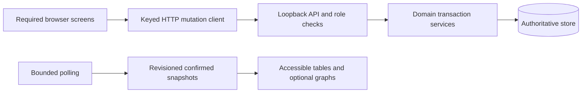

# Browser and control API design

Routes parse strict bounded input, validate a disposable fictional role, check Origin/Host, and call the domain service. They do not contain a second implementation of state transitions. Server-side role checks remain mandatory when a UI hides a control. No arbitrary handler/reducer code, URLs or paths enter the runtime.

Maintain loading, empty, disconnected, stale, forbidden, failed and pending-action states. Healthy visible views poll at a proposed one-second interval; back off disconnected reads without changing durable progress. Ignore older revisions arriving late. Persist mutation intent/key across an uncertain response and reuse it; revisions/decisions that conflict require explicit refresh and reconsideration.

Use escaped text, keyboard navigation, visible text statuses, focus-managed dialogs and complete table equivalents. The following screen contracts remain mandatory.

## Browser requirements

Screens: queue dashboard; route/binding editor; synthetic publish form; queue-entry detail; delivery/consumer view; retry timeline; dead-letter inbox with redrive review; readiness/settings/metrics page. Every screen needs loading, empty, stale, error and disconnected states.

Show ready/delayed/in-flight/ACKed/dead-lettered/expired counts with text as well as colour. Explain that pausing does not stop already granted work and ACK does not prove exactly-once external processing. Refresh must not alter delivery. Two tabs use server revisions and show conflicts. Keyboard access and an accessible table must cover every diagram action. Confirm redrive and queue deletion; never imply terminal history was erased.

API list defaults are 50/maximum 200 unless a specialized read/feed contract specifies other bounds. Return stable error code, human-readable message, bounded field details and correlation ID. See the [complete API](../contracts/api.md) for operation-specific limits and range/conflict behavior.
