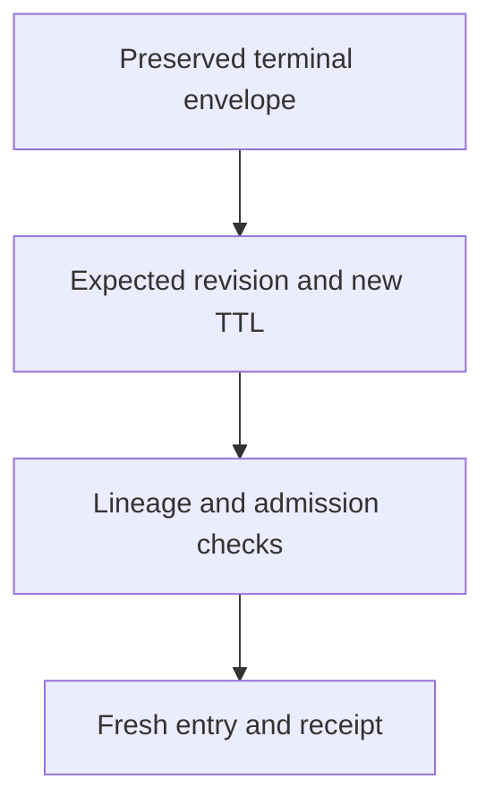

# Dead letters and controlled redrive

Default lineage redrive cap is three. A new redriven entry can dead-letter again, creating a new envelope for the next deliberate cycle. Do not reopen or mutate the old entry into READY. Separate original publish message identity from each lineage entry identity.

## Operation algorithm

1. Preserve terminal source entry, immutable payload reference, attempts and reason in one dead-letter transaction.
2. Require operator, expected dead-letter revision and a stable redrive key.
3. Check one-redrive-per-dead-letter, lineage cap, queue capacity/admission and explicitly selected fresh TTL for expired input.
4. Create fresh entry with current policy snapshot and lineage; keep source terminal and store redrive receipt.

## Inputs outputs and ownership

The service receives a validated domain request, caller/process identity, target identity, expected revision or epoch where applicable, and stable operation key. Read authoritative mutable state inside the accepting transaction. Return the committed receipt/current bounded result, or a stable error without implying acceptance. Interfaces and fields are specified in the [API](../contracts/api.md) and [data model](../contracts/data-model.md).

## Atomicity and failure handling

Publish locks one routing snapshot and all destination admission decisions in one canonical transaction. Claim protects shared capacity and authority together. ACK/NACK/expiry/redrive each commits its event and receipt with the state transition. Consumer effects use a separate store and deduplicate by queue-entry identity.

Use conditional source-state checks, uniqueness constraints and atomic audit/receipt writes. On contention roll back and retry the entire operation under bounded backoff, preserving the key. On uncertain response consult the receipt before repeating work. A stale revision/epoch requires refresh or fresh authority, never a silently rewritten request. Database unavailability stops new confirmations.

## Required behavior

## Retry expiry and dead letters

Backoff after attempt n is min(maxDelay, initialDelay × multiplier^(n−1)). Defaults: 3 attempts including the initial claim, initial delay 1 second, multiplier 2, maximum 30 seconds. Persist the calculated eligibility time; restart must not recalculate it. Optional jitter is disabled in deterministic tests.

TTL is measured from publish acceptance and continues during queue pause, retry and broker downtime. Absence of TTL means no time-based expiry, subject to storage limits and explicit retention. TTL expiry takes precedence over a new claim/ACK once its deadline is reached. Retried ACK receipts prove an old commit without reauthorizing work.

Dead-letter transfer is atomic with source-entry terminal settlement and stores a reference to immutable payload, failure reason, root message, queue, attempts and timestamps. It is an internal durable record, not an external publish that can disappear between two operations.

Redrive requires operator role, expected dead-letter revision and request key. It creates a new entry with a new ID, preserved root lineage and a fresh snapshotted policy; the old entry remains terminal. Repeated redrive requests return one new entry. A dead letter permits one accepted redrive; subsequent cycles create new dead letters. Enforce a configurable lineage redrive cap, default 3, and queue capacity. Redrive of expired input requires explicit fresh TTL selection.

## Verification boundary

Exercise each applicable acceptance row linked in [traceability](../requirements/traceability.md). Test both serialized race orders, rollback before commit and response loss after commit. Assertions inspect committed state and immutable receipts; browser messages and process logs alone are insufficient evidence.
