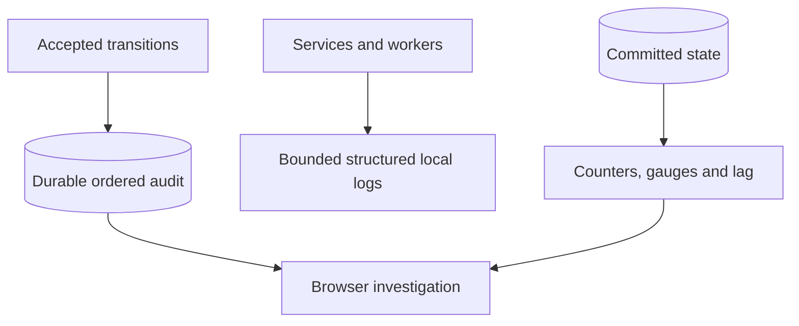

# Observability and diagnosis

Every diagnostic includes correlation ID and applicable stream/queue/replica, operation, record/event/entry and process identity. Audit is transactional evidence; process logs and metrics help explain behavior. Redact tokens and never log arbitrary full payloads by default. Heartbeats need no individual audit event.

Liveness means the process responds. Readiness requires supported schema, storage access, configuration and integrity checks. An unavailable store returns explicit not-ready and stops confirmation. Show the exact blocking reason, retained bounds/lag or pending authority so an operator can choose a safe action.

## Metrics backup and retained evidence

Track backlog by state, oldest ready age, in-flight occupancy, retry/expiry/dead-letter rates, publish/claim/ACK latency and stale-token rejection count. Keep message/entry/delivery correlation IDs in bounded logs. Metrics do not replace transaction history.

Use versioned migrations with schema compatibility checks; no automatic reset. Take a consistent snapshot of payloads, entries, policies, history and receipts together. Restore to an isolated directory, verify integrity/digests and start fresh consumer instances. A snapshot cannot recover later commits absent from it. Retain evidence and acceptance results separately from generated templates; regeneration must not overwrite actual results.

## Provisional targets

Targets must be measured on the supplied desktop and revised openly if needed: 100 queues; 100,000 retained entries; 4 producers/4 consumers; 64 KiB payload limit; 100 small-message publishes per second for 60 seconds; p95 available-capacity claim within 2 seconds; expiry/recovery within 5 seconds after due time when services are healthy; p95 paginated read under 500 ms; browser update within 3 seconds; services/store under 2 GiB steady-state RAM excluding browser/build tools. Throughput tests exclude deliberate slow handlers. These are not existing results.

Keep metrics labels bounded; individual IDs belong in drill-down views rather than unlimited time-series labels. Preserve actual measurements and failures separately from report templates.
