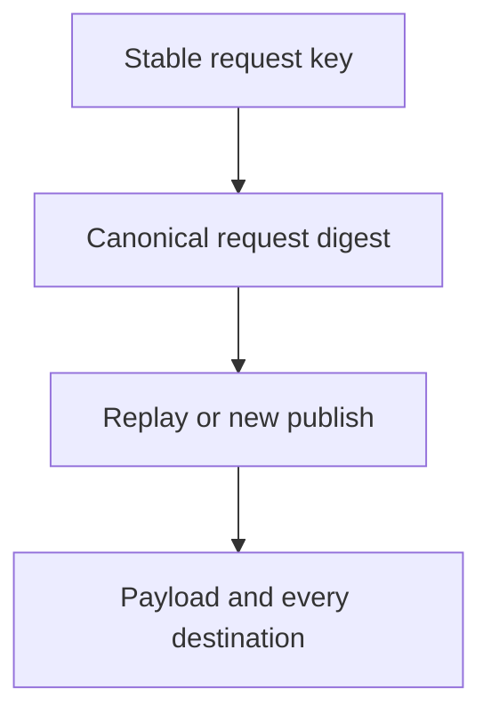

# Producer validation and receipts

Payload maximum is 64 KiB and metadata 8 KiB. Compute TTL expiry from accepted database time, not client time. A retry of a known publish returns its original destinations even if bindings later changed. No automatic receipt deletion is allowed.

## Operation algorithm

1. Bound JSON payload and metadata; validate producer, route, key and optional TTL.
2. Compute request digest including route, key, content, metadata and TTL duration.
3. Replay producer/key receipt before checking current route state; changed body returns conflict.
4. Commit immutable message, routing/policy snapshots, entries, event and receipt before success.

## Inputs outputs and ownership

The service receives a validated domain request, caller/process identity, target identity, expected revision or epoch where applicable, and stable operation key. Read authoritative mutable state inside the accepting transaction. Return the committed receipt/current bounded result, or a stable error without implying acceptance. Interfaces and fields are specified in the [API](../contracts/api.md) and [data model](../contracts/data-model.md).

## Atomicity and failure handling

Publish locks one routing snapshot and all destination admission decisions in one canonical transaction. Claim protects shared capacity and authority together. ACK/NACK/expiry/redrive each commits its event and receipt with the state transition. Consumer effects use a separate store and deduplicate by queue-entry identity.

Use conditional source-state checks, uniqueness constraints and atomic audit/receipt writes. On contention roll back and retry the entire operation under bounded backoff, preserving the key. On uncertain response consult the receipt before repeating work. A stale revision/epoch requires refresh or fresh authority, never a silently rewritten request. Database unavailability stops new confirmations.

## Required behavior

## Publish and idempotency contract

| ID | Requirement |
| --- | --- |
| PUB-01 | Publish validates producer, route, key, bounded payload and optional TTL before writing. |
| PUB-02 | A producer supplies a stable request key. Same key and canonical request returns the original receipt; different content returns conflict. |
| PUB-03 | Payload, destination entries, policy/binding snapshots, durable event and receipt commit atomically before a success response. |
| PUB-04 | Reject oversized messages before durable mutation. Default maximum payload is 64 KiB; metadata limit is 8 KiB. |
| PUB-05 | Preserve producer/key receipts while related messages or history are retained. No automatic receipt deletion in the first release. |
| PUB-06 | An uncertain response is resolved by replaying the same key. A client must not switch keys merely because the first response was lost. |

Use a documented deterministic serialization for request digests, reject duplicate JSON keys/nonfinite numbers, and define whether payload bytes are raw or canonical JSON. The digest covers route, routing key, payload, metadata and TTL. A receipt includes message ID, queue-entry IDs, binding version and accepted time.

## Ordering concurrency and transaction requirements

READY selection uses eligible timestamp then stable entry ID. Parallel consumers, retries and requeues can change completion order; strict FIFO processing is not promised. No second delivery is authorized until the prior generation has expired or been closed.

All mutations use one documented transactional protocol: check receipt, check queue/control revision and durable time, validate authority/capacity, mutate entry/delivery, write effect/event, persist receipt, then commit. Locks or serializable conditional updates must protect both candidate rows and shared capacity. Queue pause, expiry, ACK and claim races have a deterministic committed winner.

No handler computation or network I/O occurs under a storage write lock. Retry whole transactions on documented transient conflicts using bounded backoff and the same key. If commit outcome is uncertain, query/replay the durable receipt. Storage failure never produces a fabricated confirmation.

## Verification boundary

Exercise each applicable acceptance row linked in [traceability](../requirements/traceability.md). Test both serialized race orders, rollback before commit and response loss after commit. Assertions inspect committed state and immutable receipts; browser messages and process logs alone are insufficient evidence.
