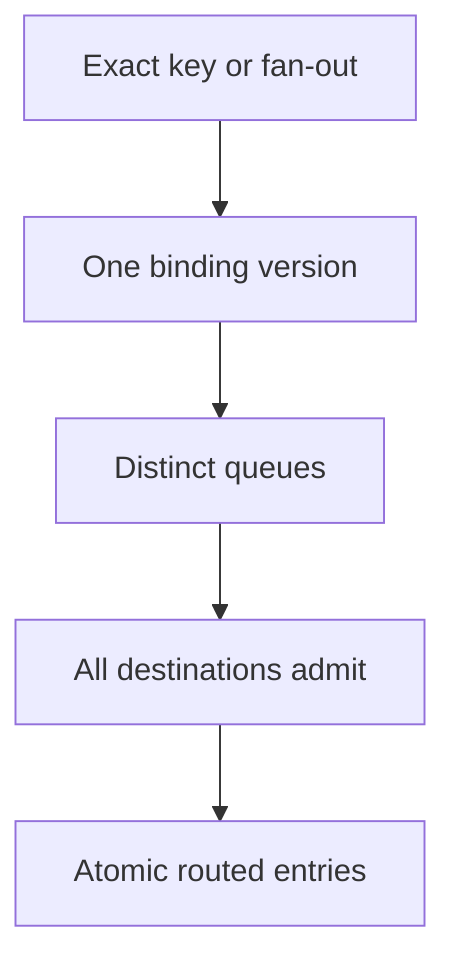

# Queue administration and atomic routing

Publishing to a paused queue is allowed; publishing to a draining queue is rejected. Updating defaults affects new entries only. An empty unbound queue can be explicitly deleted while preserving historical identity/audit; there is no destructive purge.

## Operation algorithm

1. Validate names, existing destination queues and expected settings/binding revision.
2. Read one immutable binding version; deduplicate matching destination queue IDs.
3. Under the publish transaction check every destination drain flag and capacity including READY, RETRY_WAIT and IN_FLIGHT.
4. Commit all entries or none; preserve routing version and policy snapshots in the receipt.

## Inputs outputs and ownership

The service receives a validated domain request, caller/process identity, target identity, expected revision or epoch where applicable, and stable operation key. Read authoritative mutable state inside the accepting transaction. Return the committed receipt/current bounded result, or a stable error without implying acceptance. Interfaces and fields are specified in the [API](../contracts/api.md) and [data model](../contracts/data-model.md).

## Atomicity and failure handling

Publish locks one routing snapshot and all destination admission decisions in one canonical transaction. Claim protects shared capacity and authority together. ACK/NACK/expiry/redrive each commits its event and receipt with the state transition. Consumer effects use a separate store and deduplicate by queue-entry identity.

Use conditional source-state checks, uniqueness constraints and atomic audit/receipt writes. On contention roll back and retry the entire operation under bounded backoff, preserving the key. On uncertain response consult the receipt before repeating work. A stale revision/epoch requires refresh or fresh authority, never a silently rewritten request. Database unavailability stops new confirmations.

## Detailed behavior inherited from the source

## Queue and routing requirements

| ID | Requirement |
| --- | --- |
| QUE-01 | Create named queues with finite capacity, maximum attempts, retry policy and visibility duration. Reject duplicate names. |
| QUE-02 | Configure a route as exact-key or fan-out, with versioned bindings to existing queues. A queue receives at most one copy per publish even if several bindings match. |
| QUE-03 | Route using one committed binding snapshot. Concurrent binding changes cannot partially affect a publish. |
| QUE-04 | Reject unroutable messages explicitly; do not acknowledge an accidental drop. |
| QUE-05 | If any destination lacks capacity, reject the entire publish with no queue entries or accepted receipt. Capacity includes delayed and in-flight entries. |
| QUE-06 | Pause stops new delivery claims, but existing valid deliveries may finish. Publishing to a paused queue remains allowed within limits. |
| QUE-07 | Drain stops new routed publishes while allowing existing entries to settle. A publish targeting a draining queue fails atomically. |
| QUE-08 | Initial release has no destructive queue purge. Delete only an empty, unbound queue through an explicit operation; preserve audit history. |

Mutable queue settings use expected revisions. A change must not reduce capacity below current occupancy. Retry/lease policy is snapshotted into a queue entry at routing; changing queue defaults affects new entries. Pause/drain are current admission controls, not entry policies.

## Publish and idempotency contract

| ID | Requirement |
| --- | --- |
| PUB-01 | Publish validates producer, route, key, bounded payload and optional TTL before writing. |
| PUB-02 | A producer supplies a stable request key. Same key and canonical request returns the original receipt; different content returns conflict. |
| PUB-03 | Payload, destination entries, policy/binding snapshots, durable event and receipt commit atomically before a success response. |
| PUB-04 | Reject oversized messages before durable mutation. Default maximum payload is 64 KiB; metadata limit is 8 KiB. |
| PUB-05 | Preserve producer/key receipts while related messages or history are retained. No automatic receipt deletion in the first release. |
| PUB-06 | An uncertain response is resolved by replaying the same key. A client must not switch keys merely because the first response was lost. |

Use a documented deterministic serialization for request digests, reject duplicate JSON keys/nonfinite numbers, and define whether payload bytes are raw or canonical JSON. The digest covers route, routing key, payload, metadata and TTL. A receipt includes message ID, queue-entry IDs, binding version and accepted time.

## Verification boundary

Exercise each applicable acceptance row linked in [traceability](../requirements/traceability.md). Test both serialized race orders, rollback before commit and response loss after commit. Assertions inspect committed state and immutable receipts; browser messages and process logs alone are insufficient evidence.
