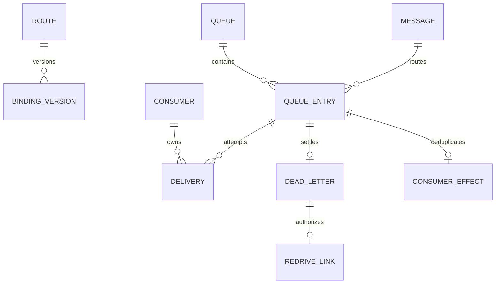

# Storage component and integrity design

The storage layer implements the atomic boundaries described by the domain services. Current state, authority, audit and receipts agree at commit. The entity relationships below are logical; cross-store associations are protocol checks rather than cross-database foreign keys.

## Keys constraints and indexes

Canonical store: unique queue name, immutable route/binding versions, unique producer/publish key, unique original routed (messageId,queueId), unique delivery (entryId,generation), and one active delivery per entry. A redrive creates a fresh entry; distinguish original routing uniqueness from redrive lineage so that it cannot accidentally prohibit the new entry.

Use a partial unique active-delivery index; unique deadLetter/sourceEntry; unique accepted redrive per deadLetter; and unique actor/operation/target/key receipt. Index READY entries by eligibleAt/id, retry due times, TTL expiry, open delivery deadlines, per-queue history sequence and scoped receipts.

Queue pause and drain are independent booleans with revision guards. Entries retain immutable retry/lease policy snapshots. Occupancy counts READY, RETRY_WAIT and IN_FLIGHT entries; in-flight authority limits additionally count active delivery rows. ConsumerEffect lives in the consumer store and uniquely keys by queueEntryId.

## Repository interfaces

Expose short transaction-scoped repository methods for receipt lookup, aggregate load, conditional transition, ordered audit allocation and outcome insert. Do not expose arbitrary table mutation to handlers or browser routes. API/coordinator code shares one domain transaction library. Return typed conflict/unavailable errors and preserve the original operation key on retry.

## Migration and durability rules

Use explicit supported schema versions, migration checksums, NOT NULL identities, foreign keys within each store, enumerated states and positive bounds. Immutable payload/receipt/history fields and terminal outcomes require service guards plus migration-level triggers. A nullable CHECK is insufficient for a mandatory identity. Do not delete records needed for receipt replay or lineage explanation.

Store JSON in the declared canonical format and bounded bytes separately from audit summaries. Persist database-evaluated UTC times and integer counters. Use a connection per bounded operation with foreign keys and durability settings verified. Avoid long read snapshots that retain excessive WAL pages. Unknown newer schemas fail readiness.

The complete entity dictionary is in [data-model contract](../contracts/data-model.md). Crash, unique-key, rollback and concurrent-writer tests remain implementation work; a documented schema is not evidence of those guarantees.
