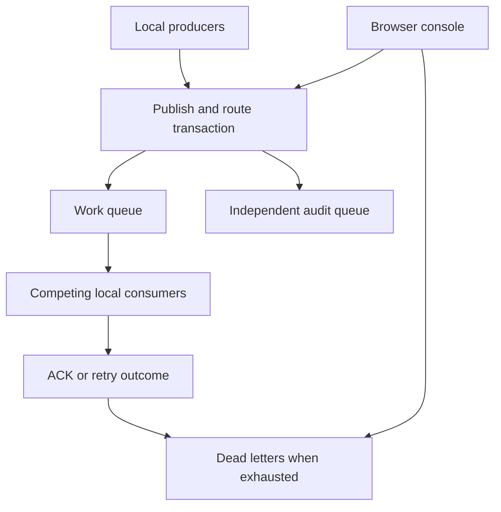

# Product requirements and scope

Publish synthetic work with a durable receipt, give consumers bounded delivery authority, and explain every retry or dead letter. A stopped process should leave recoverable records rather than an unexplained missing message.

## Purpose and success

Build a local message broker that accepts messages durably, routes them to named queues, delivers them to competing consumers, and recovers safely when a process stops. A browser interface exposes queues, deliveries, retries, dead letters and audit history.

Success means every confirmed publish remains accounted for after a restart, expired delivery authority cannot acknowledge a newer delivery, and controlled failures produce the documented redelivery behaviour. This is a one-machine reliability project, not a production RabbitMQ replacement.

The requirements are proposed engineering choices, not implemented results or programme approval. Project origin, authorship, permitted code and approval remain separate participant/reviewer decisions. Nothing here establishes that an AI-suggested project satisfies a programme's independent-origin rule.

## People and use case

| User | Need |
| --- | --- |
| Application developer | Publish synthetic work without losing it when a consumer stops. |
| Consumer developer | Receive bounded work, extend delivery authority and acknowledge outcomes. |
| Operator | Inspect backlog, pause queues, diagnose repeated failures and redrive dead letters. |
| Reviewer | Reproduce failures and inspect durable evidence of the broker's guarantees. |

The demonstration produces synthetic document-processing requests. Four local consumers calculate deterministic results. Some messages deliberately trigger a permitted test error. No real documents, addresses, accounts, employer data or external services are used.

## Environment and boundaries

All services run as ordinary local processes. APIs use loopback; the UI serves its own HTML, CSS, JavaScript and fonts. The complete demonstration must work without internet, GPU, Docker, sound, cloud services or Windows software. Check dependencies against the supplied mirror before choosing language/framework. A local transactional database is permitted; supporting several storage products is not required.

First release includes named queues, exact-key and fan-out routes, atomic routing, durable publish receipts, competing consumers, bounded delivery, visibility leases, ACK/NACK, retry backoff, expiry, dead-letter handling, queue pause/drain, local diagnostics and browser administration.

Deferred: AMQP compatibility, broker clustering, replication, external webhooks, arbitrary consumer code uploaded through the UI, priority scheduling, wildcard/topic routing, exactly-once external business effects, cloud integrations and AI infrastructure. Consumers are trusted, registered local programs with allowlisted demonstration handlers.

## Core model and guarantees

| Term | Definition |
| --- | --- |
| Message | Immutable published payload with producer identity, message ID, digest and publish receipt. |
| Queue entry | One routed copy of a message in a specific queue. Different queues have independent outcomes. |
| Delivery | One time-bounded grant to a consumer for a queue entry. |
| Delivery token | Unique entry/generation/consumer authority; only the current unexpired generation may mutate the entry. |
| ACK | Broker acceptance that this queue entry was processed; it says nothing about other queues. |
| Dead letter | Preserved terminal envelope with message, queue, failure history and reason. |
| Redrive | Explicit creation of a fresh queue entry from a dead letter, retaining lineage. |

The broker provides at-least-once delivery under the documented local storage assumptions. Delivery may repeat after a lost ACK or consumer failure. A publish confirmation means the payload, all routed entries, routing snapshot and receipt committed together. It does not mean a consumer processed the message.

Do not advertise universal exactly-once processing. The built-in consumer demonstration deduplicates its own database-contained effects with a stable queue-entry ID. External effects would need consumer cooperation and are outside scope. Process-crash tests do not prove survival of arbitrary disk failure or dishonest filesystem synchronization.

## Reference demonstration

Create a direct route `documents` with a `transform` binding, and a fan-out route `audit-copy` bound to two queues. Publish 10,000 small synthetic messages with stable producer IDs, sequence numbers and expected digests. Four local consumers process the document queue. A second queue demonstrates independent fan-out delivery.

Use separate fixtures for success, fail-first-two, permanently invalid and expiry cases so expected terminal counts are unambiguous. Generate an expected-results manifest before a run; never invent output hashes. The operator can stop a consumer, restart the broker, inspect a dead letter, and request a redrive.

