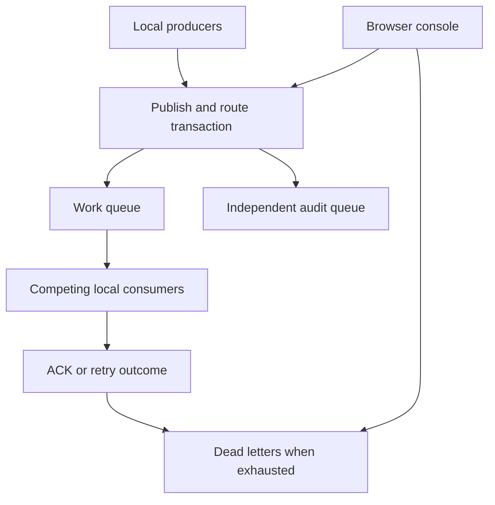

# Reliable Message Broker Requirements

Version 0.1 | 20 November 2026 | Language agnostic | Proposed first release

## 1 Purpose and success

Build a local message broker that accepts messages durably, routes them to named queues, delivers them to competing consumers, and recovers safely when a process stops. A browser interface exposes queues, deliveries, retries, dead letters and audit history.

Success means every confirmed publish remains accounted for after a restart, expired delivery authority cannot acknowledge a newer delivery, and controlled failures produce the documented redelivery behaviour. This is a one-machine reliability project, not a production RabbitMQ replacement.

The requirements are proposed engineering choices, not implemented results or programme approval. Project origin, authorship, permitted code and approval remain separate participant/reviewer decisions. Nothing here establishes that an AI-suggested project satisfies a programme's independent-origin rule.

## 2 People and use case

| User | Need |
| --- | --- |
| Application developer | Publish synthetic work without losing it when a consumer stops. |
| Consumer developer | Receive bounded work, extend delivery authority and acknowledge outcomes. |
| Operator | Inspect backlog, pause queues, diagnose repeated failures and redrive dead letters. |
| Reviewer | Reproduce failures and inspect durable evidence of the broker's guarantees. |

The demonstration produces synthetic document-processing requests. Four local consumers calculate deterministic results. Some messages deliberately trigger a permitted test error. No real documents, addresses, accounts, employer data or external services are used.

## 3 Environment and boundaries

All services run as ordinary local processes. APIs use loopback; the UI serves its own HTML, CSS, JavaScript and fonts. The complete demonstration must work without internet, GPU, Docker, sound, cloud services or Windows software. Check dependencies against the supplied mirror before choosing language/framework. A local transactional database is permitted; supporting several storage products is not required.

First release includes named queues, exact-key and fan-out routes, atomic routing, durable publish receipts, competing consumers, bounded delivery, visibility leases, ACK/NACK, retry backoff, expiry, dead-letter handling, queue pause/drain, local diagnostics and browser administration.

Deferred: AMQP compatibility, broker clustering, replication, external webhooks, arbitrary consumer code uploaded through the UI, priority scheduling, wildcard/topic routing, exactly-once external business effects, cloud integrations and AI infrastructure. Consumers are trusted, registered local programs with allowlisted demonstration handlers.

## 4 Core model and guarantees

| Term | Definition |
| --- | --- |
| Message | Immutable published payload with producer identity, message ID, digest and publish receipt. |
| Queue entry | One routed copy of a message in a specific queue. Different queues have independent outcomes. |
| Delivery | One time-bounded grant to a consumer for a queue entry. |
| Delivery token | Unique entry/generation/consumer authority; only the current unexpired generation may mutate the entry. |
| ACK | Broker acceptance that this queue entry was processed; it says nothing about other queues. |
| Dead letter | Preserved terminal envelope with message, queue, failure history and reason. |
| Redrive | Explicit creation of a fresh queue entry from a dead letter, retaining lineage. |

The broker provides at-least-once delivery under the documented local storage assumptions. Delivery may repeat after a lost ACK or consumer failure. A publish confirmation means the payload, all routed entries, routing snapshot and receipt committed together. It does not mean a consumer processed the message.

Do not advertise universal exactly-once processing. The built-in consumer demonstration deduplicates its own database-contained effects with a stable queue-entry ID. External effects would need consumer cooperation and are outside scope. Process-crash tests do not prove survival of arbitrary disk failure or dishonest filesystem synchronization.

## 5 Reference demonstration

Create a direct route `documents` with a `transform` binding, and a fan-out route `audit-copy` bound to two queues. Publish 10,000 small synthetic messages with stable producer IDs, sequence numbers and expected digests. Four local consumers process the document queue. A second queue demonstrates independent fan-out delivery.

Use separate fixtures for success, fail-first-two, permanently invalid and expiry cases so expected terminal counts are unambiguous. Generate an expected-results manifest before a run; never invent output hashes. The operator can stop a consumer, restart the broker, inspect a dead letter, and request a redrive.

## 6 Queue and routing requirements

| ID | Requirement |
| --- | --- |
| QUE-01 | Create named queues with finite capacity, maximum attempts, retry policy and visibility duration. Reject duplicate names. |
| QUE-02 | Configure a route as exact-key or fan-out, with versioned bindings to existing queues. A queue receives at most one copy per publish even if several bindings match. |
| QUE-03 | Route using one committed binding snapshot. Concurrent binding changes cannot partially affect a publish. |
| QUE-04 | Reject unroutable messages explicitly; do not acknowledge an accidental drop. |
| QUE-05 | If any destination lacks capacity, reject the entire publish with no queue entries or accepted receipt. Capacity includes delayed and in-flight entries. |
| QUE-06 | Pause stops new delivery claims, but existing valid deliveries may finish. Publishing to a paused queue remains allowed within limits. |
| QUE-07 | Drain stops new routed publishes while allowing existing entries to settle. A publish targeting a draining queue fails atomically. |
| QUE-08 | Initial release has no destructive queue purge. Delete only an empty, unbound queue through an explicit operation; preserve audit history. |

Mutable queue settings use expected revisions. A change must not reduce capacity below current occupancy. Retry/lease policy is snapshotted into a queue entry at routing; changing queue defaults affects new entries. Pause/drain are current admission controls, not entry policies.

## 7 Publish and idempotency contract

| ID | Requirement |
| --- | --- |
| PUB-01 | Publish validates producer, route, key, bounded payload and optional TTL before writing. |
| PUB-02 | A producer supplies a stable request key. Same key and canonical request returns the original receipt; different content returns conflict. |
| PUB-03 | Payload, destination entries, policy/binding snapshots, durable event and receipt commit atomically before a success response. |
| PUB-04 | Reject oversized messages before durable mutation. Default maximum payload is 64 KiB; metadata limit is 8 KiB. |
| PUB-05 | Preserve producer/key receipts while related messages or history are retained. No automatic receipt deletion in the first release. |
| PUB-06 | An uncertain response is resolved by replaying the same key. A client must not switch keys merely because the first response was lost. |

Use a documented deterministic serialization for request digests, reject duplicate JSON keys/nonfinite numbers, and define whether payload bytes are raw or canonical JSON. The digest covers route, routing key, payload, metadata and TTL. A receipt includes message ID, queue-entry IDs, binding version and accepted time.

## 8 Delivery state machine

Queue-entry states are READY, IN_FLIGHT, RETRY_WAIT, ACKED, DEAD_LETTERED and EXPIRED. ACKED, DEAD_LETTERED and EXPIRED are terminal for that entry. Message-level views summarize all entry outcomes; they do not collapse independent queues into one ACK.

| Transition | Guard and atomic outcome |
| --- | --- |
| READY to IN_FLIGHT | Queue unpaused, entry unexpired, consumer compatible and capacity available; increment generation and create delivery. |
| IN_FLIGHT to ACKED | Current consumer/token, unexpired lease and message TTL; store ACK receipt and close delivery. |
| IN_FLIGHT to RETRY_WAIT | Retryable NACK or expired lease with attempts remaining; persist next eligibility once. |
| RETRY_WAIT to READY | Due timestamp reached and TTL still valid; pause can leave it ready but unclaimable. |
| IN_FLIGHT to DEAD_LETTERED | Permanent rejection or exhausted attempt budget; preserve terminal envelope. |
| Nonterminal to EXPIRED | TTL reached; revoke any current delivery and preserve expiry reason. |

Expired delivery attempts remain in history as LOST; explicit failed attempts record NACK; acknowledged attempts record ACKED. At most one authorized in-flight generation exists per queue entry.

## 9 Claim leases and acknowledgements

| ID | Requirement |
| --- | --- |
| DEL-01 | Claim atomically checks queue state, eligibility, TTL and global/queue/consumer in-flight limits. Process-memory counters are insufficient. |
| DEL-02 | Claim records consumer instance, generation, attempt number and visibility deadline. Every claim consumes an attempt. |
| DEL-03 | Default visibility is 15 seconds with extension every 5 seconds; lease expiry is never later than message expiry. |
| DEL-04 | Extension requires current unexpired authority and cannot revive an expired generation. A fixed maximum processing deadline bounds repeated extension. |
| DEL-05 | ACK, NACK and extension carry entry ID, delivery ID, consumer ID, generation and operation key. |
| DEL-06 | Identical accepted ACK retries return the original receipt even after settlement; new stale ACKs cannot affect a newer delivery. |
| DEL-07 | Consumer registration uses a fresh process-instance ID. A restarted process does not inherit authority merely by reusing a friendly name. |
| DEL-08 | Backpressure stops issuing work when capacity is full; reads and diagnostics remain available. |

The default maximum processing duration is 60 seconds per delivery, independent of extensions. Time is sampled from the durable store's chosen wall-clock authority; exact equality to a deadline is expired. Recheck authority at the serialized mutation point. Record clock-source and clock-jump limitations.

## 10 Retry expiry and dead letters

Backoff after attempt n is min(maxDelay, initialDelay × multiplier^(n−1)). Defaults: 3 attempts including the initial claim, initial delay 1 second, multiplier 2, maximum 30 seconds. Persist the calculated eligibility time; restart must not recalculate it. Optional jitter is disabled in deterministic tests.

TTL is measured from publish acceptance and continues during queue pause, retry and broker downtime. Absence of TTL means no time-based expiry, subject to storage limits and explicit retention. TTL expiry takes precedence over a new claim/ACK once its deadline is reached. Retried ACK receipts prove an old commit without reauthorizing work.

Dead-letter transfer is atomic with source-entry terminal settlement and stores a reference to immutable payload, failure reason, root message, queue, attempts and timestamps. It is an internal durable record, not an external publish that can disappear between two operations.

Redrive requires operator role, expected dead-letter revision and request key. It creates a new entry with a new ID, preserved root lineage and a fresh snapshotted policy; the old entry remains terminal. Repeated redrive requests return one new entry. A dead letter permits one accepted redrive; subsequent cycles create new dead letters. Enforce a configurable lineage redrive cap, default 3, and queue capacity. Redrive of expired input requires explicit fresh TTL selection.

## 11 Ordering concurrency and transaction requirements

READY selection uses eligible timestamp then stable entry ID. Parallel consumers, retries and requeues can change completion order; strict FIFO processing is not promised. No second delivery is authorized until the prior generation has expired or been closed.

All mutations use one documented transactional protocol: check receipt, check queue/control revision and durable time, validate authority/capacity, mutate entry/delivery, write effect/event, persist receipt, then commit. Locks or serializable conditional updates must protect both candidate rows and shared capacity. Queue pause, expiry, ACK and claim races have a deterministic committed winner.

No handler computation or network I/O occurs under a storage write lock. Retry whole transactions on documented transient conflicts using bounded backoff and the same key. If commit outcome is uncertain, query/replay the durable receipt. Storage failure never produces a fabricated confirmation.

## 12 Recovery and shutdown

At startup verify schema and storage health before accepting mutations. Reconcile expired delivery leases, due retries and TTL expiry in bounded batches. Multiple local recovery loops must not create duplicate transitions. Do not reset persisted timestamps.

Graceful consumer shutdown stops claims and finishes or explicitly releases current work. Hard stop relies on lease expiry. Broker restart retains all confirmed publishes, current entry states and receipts. Consumers reconnect using fresh instances and reconcile uncertain ACKs with their original keys.

If storage is unavailable, stop confirmations and new grants. Return an explicit unavailable error. After reconnect, revalidate authority before accepting any result. Full-disk and transaction-conflict behaviour must be exercised without risking unrelated workspace files.

## 13 Architecture and logical records

Logical components: same-origin browser/API; routing and administration service; transactional message/queue store; delivery service; retry/expiry reconciler; independent local producers/consumers; fault harness. One broker service may combine these responsibilities initially. Multiple brokers or a consensus layer are not required.

| Entity | Essential fields and constraints |
| --- | --- |
| Queue | Nonnull ID/name, state/revision, capacity and default policy. |
| Route and binding version | Mode, exact key where relevant, immutable binding snapshot/digest. |
| Message | Producer/key, immutable payload/digest, accepted time, optional expiry. |
| QueueEntry | Unique message/queue pair for publish routing, origin/redrive lineage, policy snapshot and current state. |
| Delivery | Entry, consumer, attempt/generation, lease, processing deadline, outcome; one active authority per entry. |
| DeadLetter | Terminal entry reference, reason, preserved history and redrive receipt/reference. |
| Consumer | Instance ID, permitted queues, capacity and last contact. |
| Receipt | Unique actor/operation/target/key, request digest and committed response. |
| Event | Unique queue/sequence, entity/action/actor, bounded payload and timestamp. |
| ConsumerEffect | Demonstration-only deduplication by queue-entry ID, result and digest. |

Use explicit nonnull identity constraints, foreign keys, positive limits and enumerated states. Nullable expressions must not accidentally pass mandatory checks. Index ready entries, due retries/expiry, active deliveries and scoped receipts. Allocate audit sequence in the same transaction as the transition. Immutable payloads and terminal outcomes require service guards and appropriate storage enforcement.

## 14 API contract

Suggested endpoints; equivalent documented contracts are acceptable:

| Method and path | Behaviour |
| --- | --- |
| GET /api/health and /api/ready | Separate liveness from storage/schema readiness. |
| POST /api/queues | Create bounded queue. |
| PUT /api/queues/{id} | Revise defaults using expected revision. |
| POST /api/queues/{id}/pause, /resume, /drain | Idempotent admission control. |
| POST /api/routes and PUT /api/routes/{id}/bindings | Create/update versioned routing. |
| POST /api/messages | Keyed durable publish. |
| POST /internal/consumers/register | Register disposable local consumer instance. |
| POST /internal/queues/{id}/claim | Claim bounded entries; empty response is explicit. |
| POST /internal/deliveries/{id}/extend, /ack, /nack | Fenced delivery operations with request keys. |
| GET /api/queues/{id}/entries and /events | Filtered, paginated inspection. |
| GET /api/messages/{id} | Payload metadata and independent routing outcomes. |
| GET /api/dead-letters | Filter failures and lineage. |
| POST /api/dead-letters/{id}/redrive | Create one keyed new delivery lineage entry. |
| GET /api/consumers and /api/metrics | Capacity, heartbeat age, rates and backlog. |

Example publish body: `{"producerId":"demo-producer","route":"documents","routingKey":"transform","payload":{"fixtureId":"doc-001"},"ttlSeconds":300}`. Idempotency key is an operation-scoped header. Claim returns IDs, immutable payload reference, generation, expiry and processing deadline.

Use 400 for malformed JSON, 422 for invalid contracts, 403 for denied roles, 404 for missing resources, 409 for stale authority/revision/key conflicts, 413 for oversized input and 503 for unavailable storage. Errors include code/message/correlation ID and bounded details. Lists default to 50, maximum 200, with stable cursor ordering. Empty polls use a fresh key after a known response; transport retries preserve the previous key.

## 15 Browser requirements

Screens: queue dashboard; route/binding editor; synthetic publish form; queue-entry detail; delivery/consumer view; retry timeline; dead-letter inbox with redrive review; readiness/settings/metrics page. Every screen needs loading, empty, stale, error and disconnected states.

Show ready/delayed/in-flight/ACKed/dead-lettered/expired counts with text as well as colour. Explain that pausing does not stop already granted work and ACK does not prove exactly-once external processing. Refresh must not alter delivery. Two tabs use server revisions and show conflicts. Keyboard access and an accessible table must cover every diagram action. Confirm redrive and queue deletion; never imply terminal history was erased.

## 16 Local access and operational limits

Bind to loopback, serve assets locally, check Host/Origin and protect browser mutations against cross-site requests. Fictional producer/operator/consumer identities demonstrate authorization; they are not real account authentication. Generate disposable local session values if required and keep them out of source, URLs and logs.

Reject arbitrary URLs, paths, executable input, duplicate JSON keys, excessive nesting and unknown fields. Fault controls are disabled by default. No real API keys or production connections are required. Treat trusted local processes as the demonstration boundary; general hostile-code sandboxing is deferred.

## 17 Metrics backup and retained evidence

Track backlog by state, oldest ready age, in-flight occupancy, retry/expiry/dead-letter rates, publish/claim/ACK latency and stale-token rejection count. Keep message/entry/delivery correlation IDs in bounded logs. Metrics do not replace transaction history.

Use versioned migrations with schema compatibility checks; no automatic reset. Take a consistent snapshot of payloads, entries, policies, history and receipts together. Restore to an isolated directory, verify integrity/digests and start fresh consumer instances. A snapshot cannot recover later commits absent from it. Retain evidence and acceptance results separately from generated templates; regeneration must not overwrite actual results.

## 18 Provisional targets

Targets must be measured on the supplied desktop and revised openly if needed: 100 queues; 100,000 retained entries; 4 producers/4 consumers; 64 KiB payload limit; 100 small-message publishes per second for 60 seconds; p95 available-capacity claim within 2 seconds; expiry/recovery within 5 seconds after due time when services are healthy; p95 paginated read under 500 ms; browser update within 3 seconds; services/store under 2 GiB steady-state RAM excluding browser/build tools. Throughput tests exclude deliberate slow handlers. These are not existing results.

## 19 Acceptance catalog

All cases begin NOT RUN. Each records setup, seed, commit, environment, action/barrier, durable before/after state, receipts, timings and invariant results.

| ID | Scenario and pass condition |
| --- | --- |
| MB-AC-01 | Create queues/routes; invalid names, missing targets and duplicate bindings are rejected without partial state. |
| MB-AC-02 | Exact-key routing selects expected queues; fan-out creates one independent entry per destination. |
| MB-AC-03 | Unroutable publish and full/draining destination reject the whole transaction. |
| MB-AC-04 | Repeat publish with the same key returns one message; changed content conflicts. |
| MB-AC-05 | Restart after confirmed publish preserves all entries, payloads and receipts. |
| MB-AC-06 | Lose response after publish commit; retry returns original destination IDs. |
| MB-AC-07 | Four consumers contend; no entry has two authorized deliveries; limits hold inside each claim transaction. |
| MB-AC-08 | Kill consumer after claim; lease expiry redelivers with a newer generation. |
| MB-AC-09 | Old-generation ACK/extension cannot settle or revive a newer delivery. |
| MB-AC-10 | Lose ACK response after commit; identical replay returns original ACK receipt. |
| MB-AC-11 | Fail-first-two fixture succeeds on attempt 3 with preserved retry timestamps. |
| MB-AC-12 | Permanent rejection and exhaustion atomically preserve one dead letter. |
| MB-AC-13 | TTL expires while ready, delayed, paused or in flight; no new authority commits at/after deadline. |
| MB-AC-14 | Lease extension cannot exceed fixed processing deadline or revive expiry. |
| MB-AC-15 | Pause races claims; drain races publishes; committed order governs outcome. |
| MB-AC-16 | Binding changes race publish; every receipt identifies one complete routing snapshot. |
| MB-AC-17 | Duplicate redrive yields one new entry; lineage cap and capacity remain enforced. |
| MB-AC-18 | Storage failure produces no false confirmation; reconnect resolves uncertain operations by key. |
| MB-AC-19 | Two recovery loops settle retries/expiry once without duplicate events. |
| MB-AC-20 | Built-in consumer crashes after effect but before ACK; redelivery does not duplicate its local effect. |
| MB-AC-21 | Full 10,000-message fixture matches precomputed state counts and result digests after failures. |
| MB-AC-22 | Oversized payload, path/URL input, unexpected origin and unauthorized mutations are rejected. |
| MB-AC-23 | Browser reload/two tabs retain accurate states and show stale-control conflicts. |
| MB-AC-24 | Offline startup, snapshot restore and same-key replay preserve retained outcomes. |

## 20 Verification strategy

Unit tests cover routing, backoff, TTL arithmetic, digests and legal state transitions. Integration tests exercise actual storage constraints and transaction rollback. Concurrent-process tests use real local producers/consumers. Browser tests cover publish, pause, inspect, redrive and stale tabs.

Use deterministic barriers before/after publish commit, after delivery grant, after consumer effect before ACK, before/after ACK commit, and around expiry versus completion. Repeat each crash window at least 20 times and contention/stale-authority cases at least 100 rounds. Preserve failing seeds and rounds. Run a 30-minute bounded soak.

Invariants: every confirmed publish has all destination entries; no orphan payload/entry; one authorized generation per entry; terminal entries never reopen; capacity bounds hold; accepted changes have audit events; dead-letter/redrive lineage remains traceable; stale authority cannot ACK; messages remain accounted for. Protocol-level redelivery is allowed and must be visible, not hidden by an incorrect no-duplicates claim.

## 21 Session plan

| Milestone | Work and checkable exit |
| --- | --- |
| 1 | Choose verified tools/storage; local browser, readiness and schema migration work. |
| 2 | Implement queues and route validation; exact and fan-out fixtures pass. |
| 3 | Implement atomic publish/receipts; lost-response tests pass. |
| 4 | Implement delivery grants and in-flight limits; competing consumers pass. |
| 5 | Add leases/fencing/ACK/NACK; hard-kill and stale-token tests pass. |
| 6 | Add backoff, TTL and recovery loop; restart preserves due times. |
| 7 | Add dead letters/redrive and admission controls; race tests pass. |
| 8 | Complete browser investigation and local authorization flows. |
| 9 | Execute fixture, load, soak, backup and offline acceptance; record limitations. |

Each milestone may span several sessions. End with runnable behaviour, relevant tests, a commit/checkpoint and continuation notes. Do not substitute documentation checks for runtime acceptance.

## 22 Delivery and open decisions

Deliver source/licence notices, local startup scripts, schema migrations, API contracts, fixture generator/expected outputs, browser application, consumer examples, crash harness, acceptance report, measurements, consistent backup/restore instructions and session history.

Before implementation decide the language/framework, one transactional store, canonical serialization, exact capacity/TTL defaults and permitted package versions. Release requires every mandatory acceptance case and repetition gate to pass offline, retained evidence for crashes, and no unresolved defect invalidating the stated guarantees. No programme approval is implied by a completed specification.

## 23 Primary references

- RabbitMQ publisher confirms and consumer acknowledgements: https://www.rabbitmq.com/docs/confirms
- RabbitMQ dead-letter concepts: https://www.rabbitmq.com/docs/dlx
- SQLite atomic commit principles: https://www.sqlite.org/atomiccommit.html

These are conceptual references. This project's protocol and scope are deliberately smaller and make no claim of wire compatibility or equivalent production guarantees.
