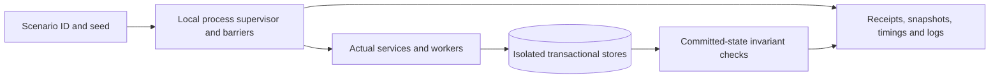

# Failure harness and deterministic fixtures

Publish 10,000 seeded synthetic document-processing messages. Keep success, fail-first-two, permanent-failure and expiry fixtures separate so terminal counts are unambiguous. Calculate actual expected digests before execution with an independent oracle; use four consumers and a second independent fan-out destination.

Each test owns a fresh runtime directory, database paths, loopback ports, synthetic identities and tracked PIDs. Only stop processes created by this harness. Fault controls are disabled by default and require explicit test mode and a separate disposable local capability. No fault endpoint should be callable in ordinary operation.

Use acknowledged named barriers before commit, after commit before response, after grant/fetch, before progress application, and around authority replacement. Kill the process that owns the transaction when proving rollback; dropping a response after commit is a different experiment. No random sleep substitutes for a proven boundary.

Repeat each crash window at least 20 times; conflicting/ownership/contention races at least 100 rounds. Preserve failing seeds and rounds. Run a bounded 30-minute soak and the complete journey offline with loopback available. Hash expected output using an independent oracle and canonical ordering; actual hashes are NOT GENERATED until implementation.

Record build/commit, OS/CPU/RAM/store versions, durability settings, configuration, fixture seed, IDs/ranges, barrier acknowledgements, before/after snapshots, HTTP receipts, timing and invariant outcome. [Acceptance plan](acceptance-plan.md) supplies every source case. Runtime tests are NOT RUN.
